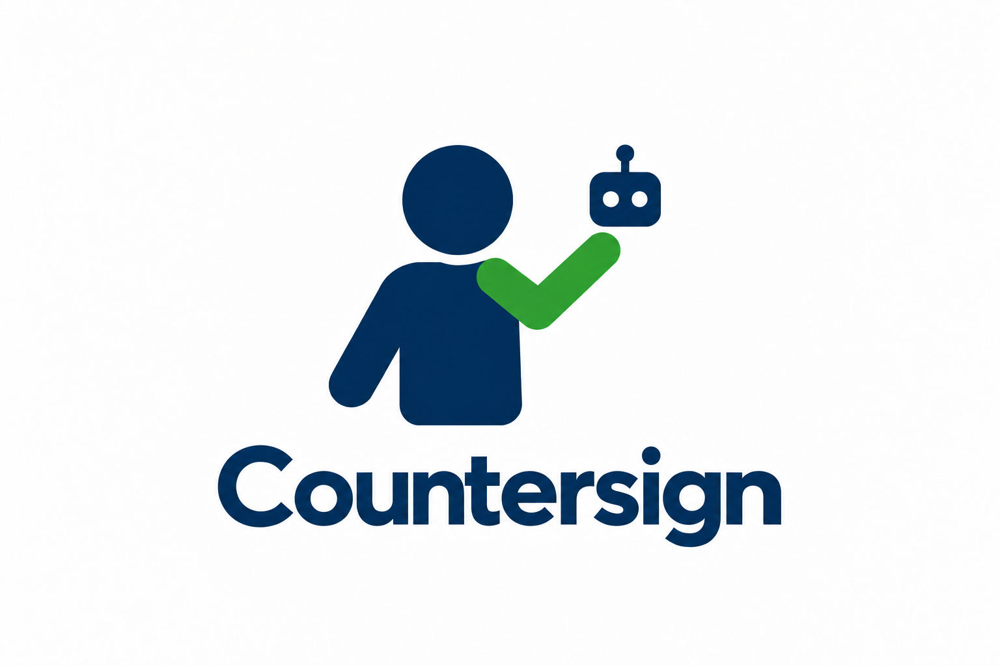
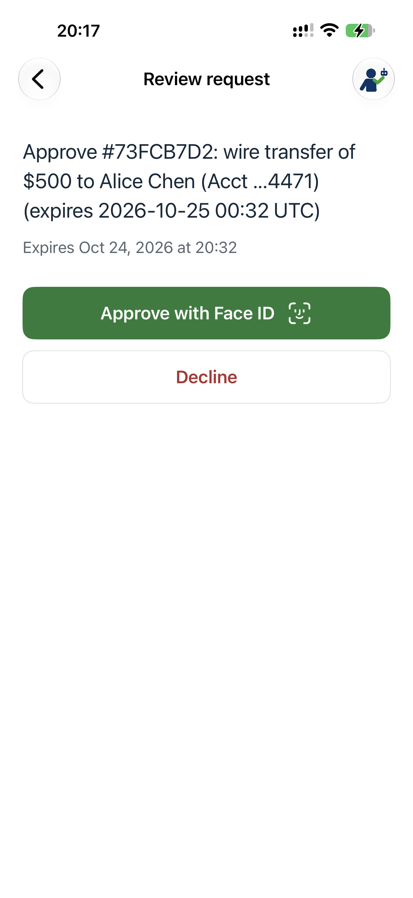
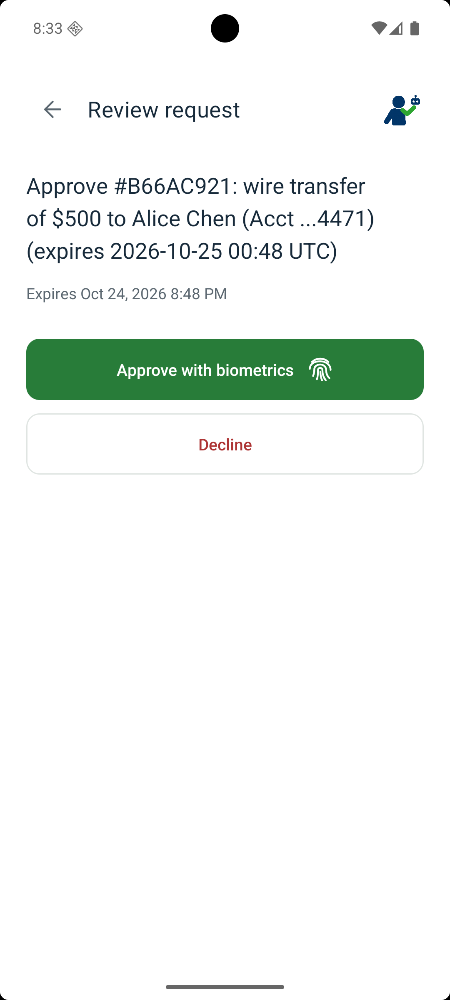

# Countersign

<p align="center">
  
</p>

Countersign is a human approval demo for Android and iOS. A backend sends a request, the user reviews its exact text and expiry, and biometric authentication unlocks a key that signs the approval. The backend verifies the signature before accepting it. The wire-transfer examples do not move money.

| iPhone | Android |
| --- | --- |
|  |  |

[More screenshots](demo/README.md)

## Run the demo

Follow the guide for your device:

| Device | Verification | Setup                                                                              |
| --- | --- |------------------------------------------------------------------------------------|
| Android emulator | Simulated attestation and Play Integrity; biometric prompts and approval signatures still run | [Emulator](android/countersign-app/README.md#emulator-demo)                        |
| Physical Android | Android Key Attestation and Google Play Integrity | [Android](android/countersign-app/README.md#physical-device-with-real-attestation) |
| Physical iPhone with the latest iOS | Apple App Attest enrollment and biometric-gated Secure Enclave signing; Apple Developer Program membership required | [iPhone](ios/countersign-app/README.md)                                            |

Every enrollment needs administrator approval before it can receive requests. iOS Simulator cannot run the enrollment/signing demo.

This is a prototype, with known verification limitations. Read the short [security notes](docs/SECURITY.md) before deploying beyond a controlled demo.

## Development

Use Python 3.13+ and [uv](https://docs.astral.sh/uv/getting-started/installation/):

```sh
uv sync --frozen
uv run pytest
```

With Node.js installed, run the demo-page regression checks with `node --test tests/demo_page.test.cjs`.

The backend is in `service/`; the mobile projects are in `android/countersign-app/` and `ios/countersign-app/`. Tests and public attestation fixtures are in `tests/`. Credentials, signing keys, local databases, and build output are excluded from Git.

## License

[MIT](LICENSE). Third-party fixtures and the Gradle wrapper retain their upstream licenses.
